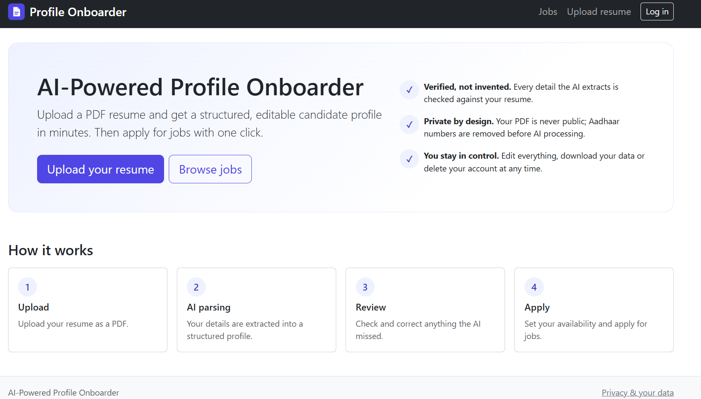
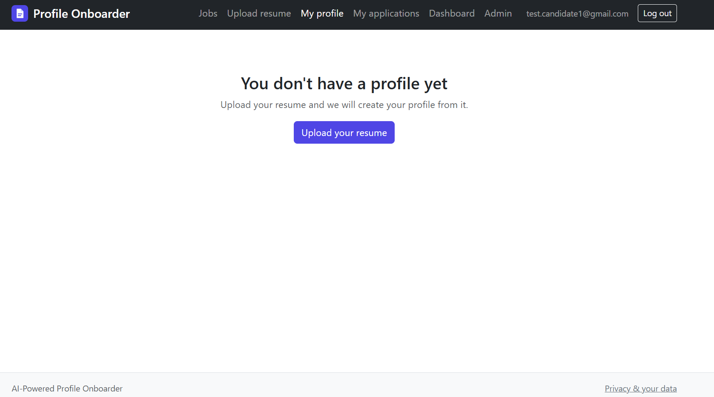
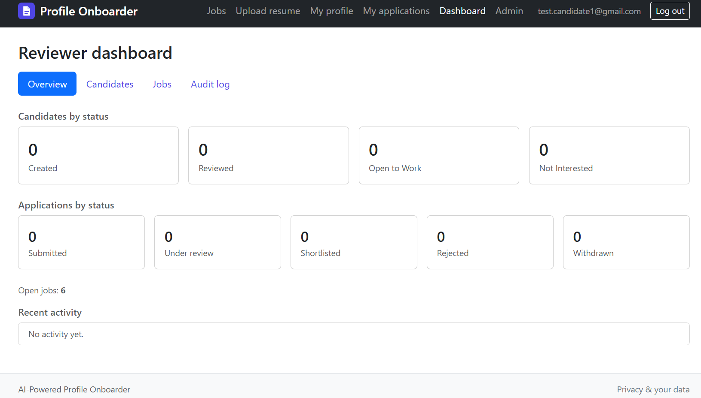
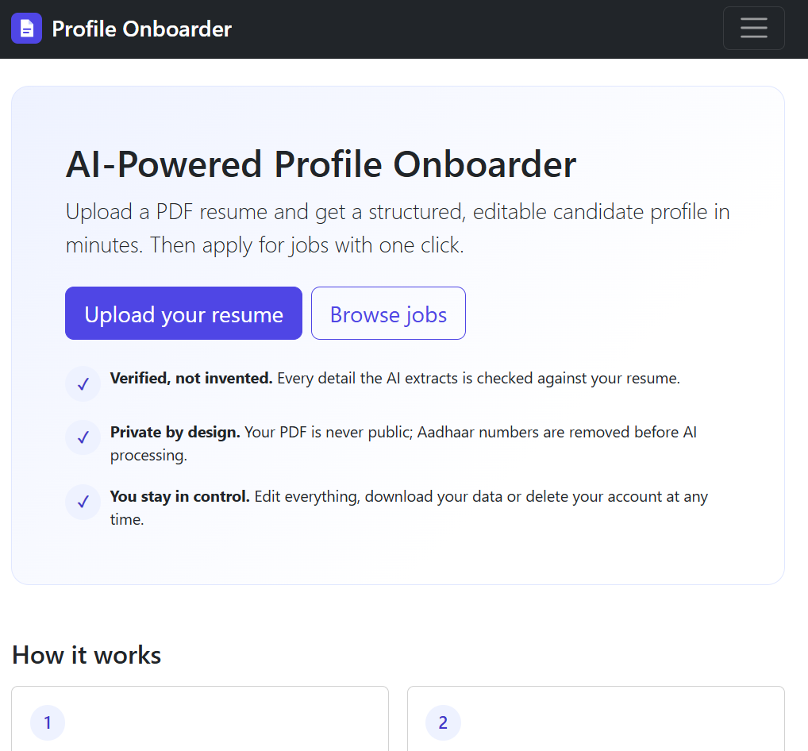
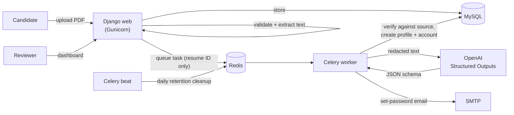

# AI-Powered Profile Onboarder

[](https://github.com/UpparaAbhilash/ai-profile-onboarder/actions/workflows/tests.yml)


Upload a PDF resume and get a **structured, verified, editable candidate profile** in seconds.
A Django + Generative AI application with background processing, a reviewer dashboard,
a job application workflow and privacy built in (GDPR self-service, data retention, audit log).



---

## The problem

Recruiting platforms ask candidates to type their whole resume into forms, again and again.
Simply letting an AI fill the form is risky: language models can **invent** details, and resumes
contain sensitive data (date of birth, national ID numbers) that should not be sent anywhere unnecessarily.

## The solution

1. The candidate uploads a PDF. It is validated (real PDF, size, pages) and its text is extracted.
2. Sensitive IDs (Aadhaar numbers) are **removed before** the text goes to the AI.
3. The AI returns data in a **strict JSON schema** (OpenAI Structured Outputs).
4. **Every extracted value is checked against the original resume text**; anything that is not in the resume is discarded.
5. An account and profile are created; the candidate verifies everything, completes missing fields and applies for jobs.
6. Reviewers search candidates, see a transparent score and skill match, and move applications through a pipeline.

## Features

| For candidates | For reviewers | Platform |
|---|---|---|
| PDF upload with early checks and live status page | Dashboard with candidate search (skills, city, experience, score) | Background AI parsing with retries (Celery + Redis) |
| AI-filled profile, fully editable (projects, certifications) | Jobs pipeline sorted by skill match | Role-based access (least privilege), IDOR-safe URLs |
| Account created automatically, one-time set-password link | Status workflow with history and audit log | Login rate limiting, CSP, secure headers |
| Transparent 0–100 profile score with tips | CSV export **without** contact details, DOB or ID numbers | Daily GDPR retention cleanup (Celery beat) |
| Job search, apply, withdraw, re-apply | Audit log browser (who viewed which profile) | Docker stack, CI pipeline, 255 automated tests |
| Download my data (JSON), delete my account | | Accessible, mobile-friendly UI |

| Upload and live status | Reviewer dashboard | Mobile |
|---|---|---|
|  |  |  |

*All screenshots use generated test data.*

## Architecture



## Tech stack

| Area | Technology |
|---|---|
| Backend | Python 3.13, Django 5.2 LTS, MySQL 8.4 |
| AI | OpenAI Responses API with Structured Outputs, Pydantic schemas |
| PDF | PyMuPDF (validation and text extraction) |
| Background jobs | Celery 5, Redis (JSON-only messages) |
| Frontend | Django templates, Bootstrap 5.3, small vanilla JS (no inline scripts) |
| Deployment | Docker multi-stage image, Gunicorn, WhiteNoise, Docker Compose |
| Quality | Django test runner (255 tests, ~92 % branch coverage), coverage.py, GitHub Actions, gitleaks, pip-audit |

## Key engineering decisions

- **Verify, don't trust the AI.** Structured Outputs guarantee the *shape* of the answer, not its truth. Every value is matched against the resume text; invented emails, skills or companies are dropped and reported as warnings.
- **Data minimisation.** Aadhaar numbers are redacted before AI processing and only the last 4 digits are stored. Reviewer CSV exports exclude contact details, date of birth and ID numbers. Background tasks receive IDs only, so no personal data sits in Redis.
- **Service layer.** Views stay thin; business rules (status transitions, scoring, applications, privacy) live in testable service functions.
- **Explicit state machines** for profile and application status, with row locks against race conditions and an audit trail.
- **Reliable background work.** Tasks are queued with `transaction.on_commit`, are idempotent, and retry only temporary AI errors (timeouts, rate limits, 5xx) with backoff; permanent errors fail fast and cost nothing.
- **Privacy as a feature.** Users can download all their data and delete their account; the deletion also removes the PDF files that Django would leave behind. Unclaimed data is purged automatically after 30 days.
- **Security in depth.** Content Security Policy without inline scripts (enforced by a test), login rate limiting in the authentication backend (covers the admin too), no account enumeration, `check --deploy` clean in production configuration. See [SECURITY.md](SECURITY.md) for the full OWASP Top 10:2025 mapping.

## Run it with Docker (one command)

Requirements: Docker Desktop.

```bash
git clone https://github.com/UpparaAbhilash/ai-profile-onboarder.git
cd ai-profile-onboarder
cp .env.docker.example .env.docker   # then set passwords and a secret key
docker compose up --build -d
docker compose exec web python manage.py createsuperuser
docker compose exec web python manage.py setup_roles
docker compose exec web python manage.py seed_jobs
```

Open <http://127.0.0.1:8080>. Without an OpenAI key the app runs fully; only the AI parsing step reports "not configured".

| Service | Purpose |
|---|---|
| `web` | Django on Gunicorn, static files via WhiteNoise |
| `worker` | Celery: AI resume parsing in the background |
| `beat` | Celery scheduler: daily GDPR retention cleanup |
| `db` / `redis` | MySQL 8.4 / Redis (internal network only) |
| `migrate` | Runs database migrations once, then exits |

## Local development (Windows PowerShell)

```powershell
py -3.13 -m venv .venv
.\.venv\Scripts\Activate.ps1
python -m pip install -r requirements-dev.txt
Copy-Item .env.example .env          # then fill in your own values
python manage.py migrate
docker run -d --name onboarder-redis -p 127.0.0.1:6379:6379 redis:7.4-alpine
celery -A config worker --pool=solo --loglevel=info   # terminal 1
python manage.py runserver                             # terminal 2
```

## Tests and quality checks

```bash
python manage.py test --keepdb                            # 255 tests, about 6 seconds
coverage run manage.py test --keepdb && coverage report   # ~92 % branch coverage
python manage.py check --deploy
pip-audit
```

Tests never call the paid AI service or need Redis: the AI client is faked and Celery runs eagerly.
CI runs all of the above on every push, plus a missing-migrations check and a gitleaks secret scan.

## Project structure

```text
accounts/    login with rate limiting, onboarding emails, privacy (export, deletion, retention)
resumes/     upload, PDF validation and extraction, AI parser, Celery tasks
profiles/    candidate profile, editing, status workflow, scoring
jobs/        job listings, applications, skill match
dashboard/   reviewer dashboard, candidate search, pipeline, audit log, CSV export
config/      settings, URLs, Celery app, security headers middleware, health check
templates/   base layout and shared UI partials
```

## Limitations and next steps

- Scanned (image-only) PDFs are detected and rejected; OCR would be the next step.
- Not publicly hosted on purpose (running costs and paid AI usage). The same Docker Compose stack runs on any Linux server.
- Production would use Redis as Django cache, so login rate limits are shared between processes.
- Uploaded files are validated but not virus-scanned.

## Development log

This project was built step by step as a learning and portfolio project.

<details>
<summary>All phases</summary>

- [x] Phase 1 — Environment setup
- [x] Phase 2 — Django project, apps, custom User model
- [x] Phase 3A — MySQL database connected
- [x] Phase 3B — Core data models (resumes, profiles, jobs, applications, audit log)
- [x] Phase 4A — PDF validation and text extraction services
- [x] Phase 4B — Resume upload page, protected download, access control
- [x] Phase 5A — AI parser service: Pydantic schema, Aadhaar redaction, source verification, tests
- [x] Phase 5B — AI parsing in the upload flow, results page, reparse command
- [x] Phase 6A — Profile import from parsed resume, candidate login, My profile page
- [x] Phase 6B — Edit profile with validation, projects/certifications formsets, ownership tests
- [x] Phase 7A — Automatic accounts, set-password links, password reset, verified resume linking
- [x] Phase 7B — Real email delivery via SMTP (Gmail App Password), configured only through .env
- [x] Phase 8A — Profile status workflow (state machine, permissions, history, audit log)
- [x] Phase 8B — Transparent 0–100 profile score with breakdown and improvement tips
- [x] Phase 9 — Job listings with search, applications, withdraw/re-apply, reviewer workflow
- [x] Phase 10A — Reviewer role, dashboard overview, candidate search/filters, review actions
- [x] Phase 10B — Jobs pipeline sorted by skill match, audit log browser, safe CSV export
- [x] Phase 11A — Redis (Docker, localhost only) + Celery worker, JSON-only messages, eager mode in tests
- [x] Phase 11B — Background AI parsing with Celery: on_commit queueing, retries with backoff, idempotent tasks, auto-refreshing status page
- [x] Phase 12A — Test suite sped up (fast test hasher, --keepdb), coverage reporting, reparse --queue repair command
- [x] Phase 12B1 — Security headers + Content Security Policy, HTTPS settings via .env, check --deploy, pip-audit, error-path tests
- [x] Phase 12B2 — Login rate limiting (per email + per IP, admin included), SECURITY.md with OWASP Top 10:2025 mapping
- [x] Phase 12C1 — Data retention: account erasure incl. files, purge_old_data command
- [x] Phase 12C2 — GDPR self-service: privacy page, "Download my data" (JSON), "Delete my account" with re-authentication
- [x] Phase 13A — Design tokens, accessibility basics, new home page, upload UX
- [x] Phase 13B — Reusable UI partials, one colour per status, helpful empty states, stacked tables on mobile
- [x] Phase 14A — Docker: multi-stage image, Gunicorn, WhiteNoise, Compose stack with Celery worker and beat, health check
- [x] Phase 14B — GitHub Actions CI, secret scan, Docker quickstart
- [x] Phase 15 — Showcase README, screenshots, public repository

</details>

## Author

Built by **Abhilash Uppara** (Master's student at SRH university of Applied Sciences , Berlin) as a hands-on project in Django, Generative AI and secure, privacy-aware web development.